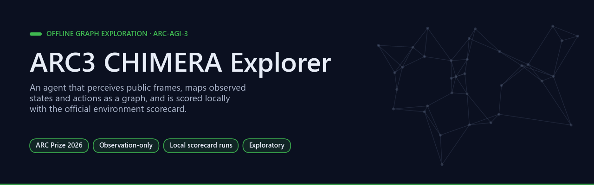
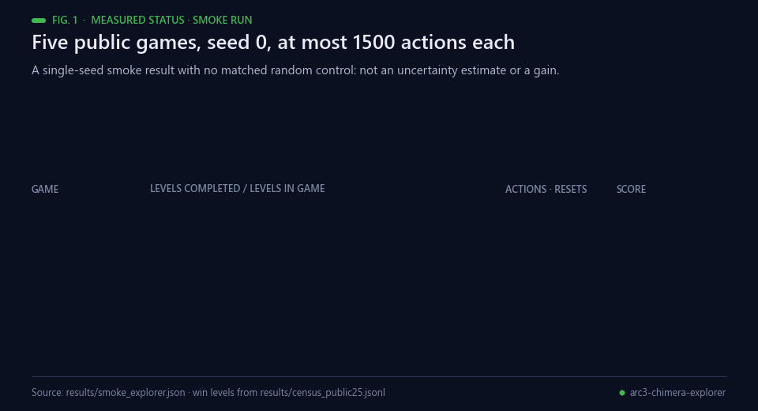
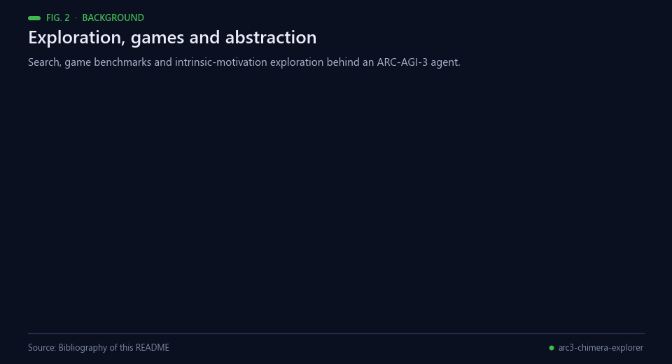
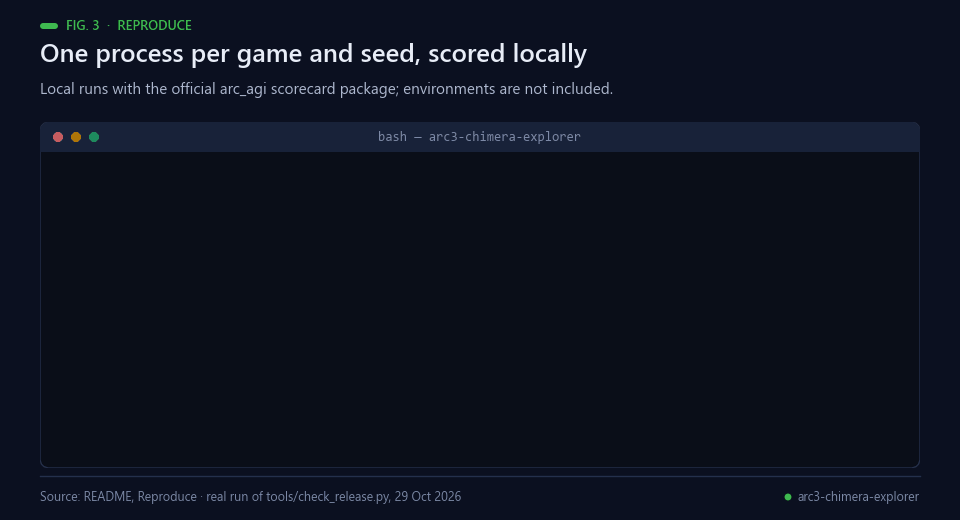
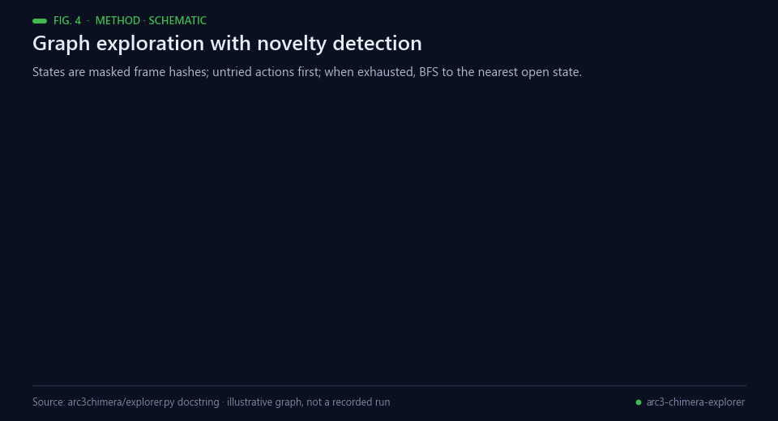
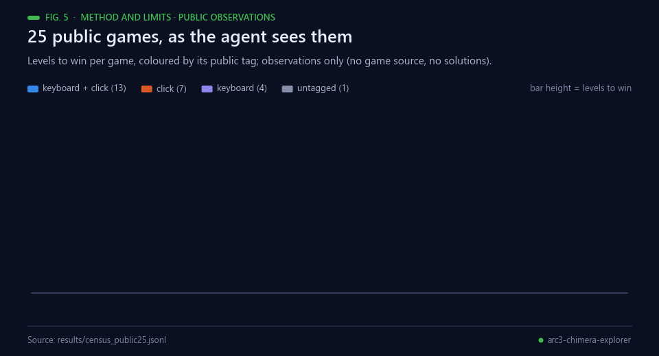
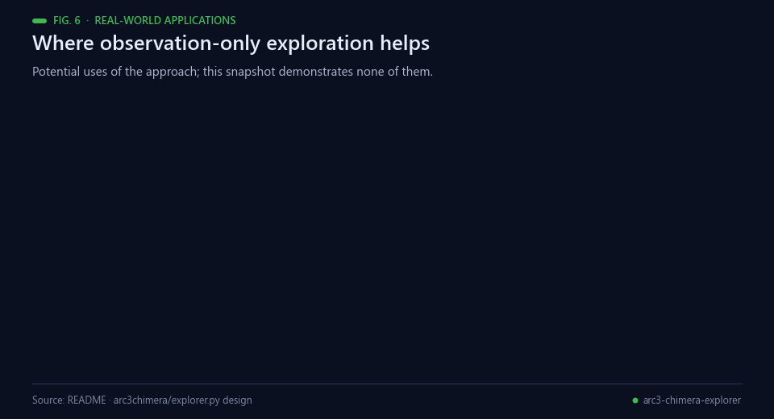
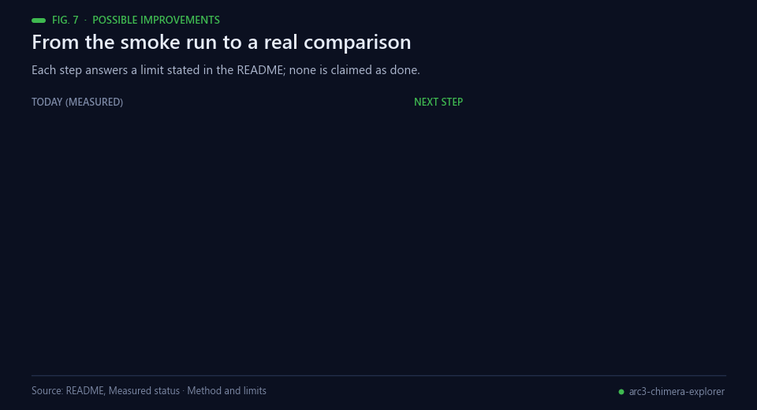
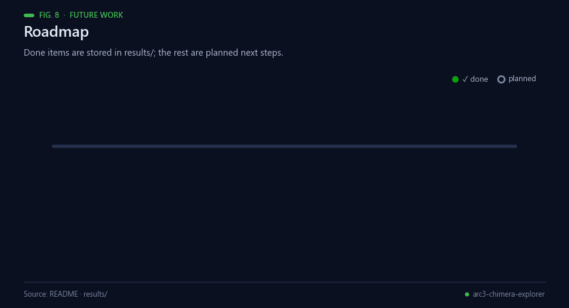

<div align="center">



# ARC3 CHIMERA Explorer

[](https://github.com/Agnuxo1/arc3-chimera-explorer/actions/workflows/release.yml) [](LICENSE)  [](docs/RESEARCH_PROTOCOL.md) [](https://www.kaggle.com/competitions/arc-prize-2026-arc-agi-3)

[**Measured status**](#measured-status) · [**Reproduce**](#reproduce) · [**Method and limits**](#method-and-limits) · [**Raw run**](results/smoke_explorer.json) · [**Research protocol**](docs/RESEARCH_PROTOCOL.md) · [**Competition**](https://www.kaggle.com/competitions/arc-prize-2026-arc-agi-3)

</div>

An offline graph-exploration research prototype for [ARC-AGI-3](https://www.kaggle.com/competitions/arc-prize-2026-arc-agi-3), built from our CHIMERA research direction. It perceives public frames, tracks observed states and actions, and evaluates with the official environment scorecard. It does not inspect hidden game source or solutions.

**Contents** — [Measured status](#measured-status) · [Background](#background) · [Reproduce](#reproduce) · [Method and limits](#method-and-limits) · [Real-world applications](#real-world-applications) · [Possible improvements](#possible-improvements) · [Future work](#future-work) · [Bibliography](#bibliography)

## Measured status

<p align="center"><br><sub>Fig. 1 — The stored smoke run. Data: results/smoke_explorer.json; levels per game from results/census_public25.jsonl.</sub></p>

The stored exploratory smoke run covered five public games, seed 0 and at most1500 actions/game: mean score **0.0058973574**, one completed level, zero recorded exceptions. [Raw run](results/smoke_explorer.json). This is a single-seed smoke result, with no matched random-control comparison. Standard deviation0 across one seed is not an uncertainty estimate. No official submission or competitive improvement is established by this snapshot.

## Background

<p align="center"><br><sub>Fig. 2 — Search, game benchmarks and exploration research behind this agent. Sources: bibliography below.</sub></p>

ARC was proposed as a measure of skill-acquisition efficiency — how quickly a system learns a new task from little
experience [[1](#ref-1)]. ARC-AGI-3 moves that idea from static grids to interactive games, in which an agent has to
discover each environment's controls, rules and goals by acting in it [[2](#ref-2), [3](#ref-3)]. Video games have served as
agent benchmarks for more than a decade: the Arcade Learning Environment and deep Q-networks learning from pixels
made them standard [[11](#ref-11), [12](#ref-12)]. The exploration problem they expose has its own literature — count-based
novelty bonuses [[4](#ref-4)], curiosity from prediction error [[5](#ref-5)], random network distillation [[6](#ref-6)] and
Go-Explore, which remembers promising states and returns to them before exploring further [[7](#ref-7)]. Classical graph
search, from breadth-first search to A* [[8](#ref-8)], supplies the deterministic backbone, and core-knowledge accounts of human cognition describe the
priors (objects, agents, number, geometry) that such tasks are designed around [[9](#ref-9), [10](#ref-10)].

This repository is a deliberately simple, learning-free control in that tradition. It hashes observed frames
(volatile cells masked) into a state graph, tries untried actions in a fixed salience order, walks the known graph by
breadth-first search to the nearest state that still has untried actions, and avoids transitions that ended in
GAME_OVER. It comes from the author's CHIMERA research direction [[13](#ref-13)]; the CHIMERA policy itself is reserved and
not implemented in this snapshot.

## Reproduce

<p align="center"><br><sub>Fig. 3 — Commands from this section; the release check is a real local run.</sub></p>

```bash
python -m pip install -r requirements.txt
python -m arc3chimera.runner --env-dir /path/to/official/environments --policy explorer --seeds 0 --games ft09,lp85,ls20,tu93,vc33 --max-actions 1500 --workers 1 --out /tmp/explorer.json
```

Use the game IDs available in your official environment release; the IDs above reproduce the stored smoke selection and may differ in another release. `--policy random` supplies the control. Follow-up comparisons must freeze the same games and action/time budget and use at least three seeds. Only `explorer` and `random` are implemented in this snapshot; the reserved `chimera` option has no implementation and must not be used.

## Method and limits

<p align="center"><br><sub>Fig. 4 — Schematic of <code>arc3chimera/explorer.py</code>; illustrative graph, not a recorded run.</sub></p>

`arc3chimera/perception.py` extracts observed frame information; `explorer.py` maintains graph exploration; `runner.py` isolates each game/seed in a process and records exceptions. `results/census_public25.jsonl` describes public observations only. No environment bundle, weights or private game data are included. Inspect exact versions of the official `arc-agi` and `arcengine` release before comparing scores. This exploratory snapshot is not a three-seed confirmation or an official result.

<p align="center"><br><sub>Fig. 5 — Public observations only. Data: results/census_public25.jsonl.</sub></p>

See [research protocol](docs/RESEARCH_PROTOCOL.md). Original project code: MIT; dependencies retain their own licences. No prize, affiliation or organiser endorsement is claimed.

## Real-world applications

<p align="center"><br><sub>Fig. 6 — Potential uses of observation-only exploration; this snapshot demonstrates none of them.</sub></p>

- **Automated game testing.** Map the reachable states of a level and flag dead ends or crashes without access to
  the game's source code.
- **User-interface exploration.** Click and keyboard agents can enumerate the screens of an application as a state
  graph for regression testing.
- **Safe exploration.** Transitions that ended in failure are marked and avoided on later visits, a simple form of
  caution without learning.
- **State-space mapping.** Frame hashing plus breadth-first search gives a cheap map of what an unknown interactive
  system can do.
- **Benchmark baselines.** A transparent, learning-free control against which world-model agents can be compared
  under the same local scorecard.
- **Teaching exploration research.** Per-game records and exceptions make experiments easy to audit.

## Possible improvements

<p align="center"><br><sub>Fig. 7 — Each improvement answers a limit stated in this README.</sub></p>

- **More than one seed.** A standard deviation of 0 over one seed is not an uncertainty estimate; follow-ups need at
  least three seeds on frozen games and budgets.
- **A matched random control.** `--policy random` exists but no matched comparison has been run.
- **Learning across levels.** One level was completed across five games. The explorer already exposes
  `rank_untried` and `learn` hooks, so a learned forward model, as used for curiosity [[5](#ref-5)], could re-rank untried
  actions.
- **The CHIMERA policy.** The reserved `chimera` option has no implementation and must not be used until it does.

## Future work

<p align="center"><br><sub>Fig. 8 — Done items are stored in results/; the rest are planned.</sub></p>

1. Run the matched random control on the same five games, action budget and time budget.
2. Confirm with at least three seeds under a frozen protocol, as the README requires.
3. Add a world model behind `rank_untried` / `learn` and compare it with both controls.
4. Implement the reserved CHIMERA policy and test it the same way.
5. Check the exact `arc-agi` and `arcengine` versions before any comparison with official scores.

## Bibliography

1. <a id="ref-1"></a>Chollet, F. (2019). On the Measure of Intelligence. *arXiv* 1911.01547. https://arxiv.org/abs/1911.01547
2. <a id="ref-2"></a>ARC Prize Foundation. *ARC-AGI-3: interactive reasoning benchmark* (website). https://arcprize.org/arc-agi/3/
3. <a id="ref-3"></a>ARC Prize Foundation & Kaggle (2026). *ARC Prize 2026: ARC-AGI-3* (competition). https://www.kaggle.com/competitions/arc-prize-2026-arc-agi-3
4. <a id="ref-4"></a>Bellemare, M. G., Srinivasan, S., Ostrovski, G., et al. (2016). Unifying Count-Based Exploration and Intrinsic Motivation. *arXiv* 1606.01868. https://arxiv.org/abs/1606.01868
5. <a id="ref-5"></a>Pathak, D., Agrawal, P., Efros, A. A., & Darrell, T. (2017). Curiosity-driven Exploration by Self-supervised Prediction. *arXiv* 1705.05363. https://arxiv.org/abs/1705.05363
6. <a id="ref-6"></a>Burda, Y., Edwards, H., Storkey, A., & Klimov, O. (2018). Exploration by Random Network Distillation. *arXiv* 1810.12894. https://arxiv.org/abs/1810.12894
7. <a id="ref-7"></a>Ecoffet, A., Huizinga, J., Lehman, J., Stanley, K. O., & Clune, J. (2021). First return, then explore. *Nature*, 590(7847), 580–586. https://doi.org/10.1038/s41586-020-03157-9
8. <a id="ref-8"></a>Hart, P., Nilsson, N., & Raphael, B. (1968). A Formal Basis for the Heuristic Determination of Minimum Cost Paths. *IEEE Transactions on Systems Science and Cybernetics*, 4(2), 100–107. https://doi.org/10.1109/TSSC.1968.300136
9. <a id="ref-9"></a>Spelke, E. S., & Kinzler, K. D. (2006). Core knowledge. *Developmental Science*, 10(1), 89–96. https://doi.org/10.1111/j.1467-7687.2007.00569.x
10. <a id="ref-10"></a>Lake, B. M., Ullman, T. D., Tenenbaum, J. B., & Gershman, S. J. (2016). Building machines that learn and think like people. *Behavioral and Brain Sciences*, 40. https://doi.org/10.1017/S0140525X16001837
11. <a id="ref-11"></a>Bellemare, M. G., Naddaf, Y., Veness, J., & Bowling, M. (2013). The Arcade Learning Environment: An Evaluation Platform for General Agents. *Journal of Artificial Intelligence Research*, 47, 253–279. https://doi.org/10.1613/jair.3912
12. <a id="ref-12"></a>Mnih, V., Kavukcuoglu, K., Silver, D., et al. (2015). Human-level control through deep reinforcement learning. *Nature*, 518(7540), 529–533. https://doi.org/10.1038/nature14236
13. <a id="ref-13"></a>Angulo de Lafuente, F. *ARC2_CHIMERA: research proof-of-concept for ARC-AGI* (software). https://github.com/Agnuxo1/ARC2_CHIMERA

---

<div align="center">
<sub>Built by <a href="https://github.com/Agnuxo1">Francisco Angulo de Lafuente</a> · every figure is an animated
rendering of the published file named in its footer · <a href="#arc3-chimera-explorer">back to top ↑</a></sub>
</div>
